  <a href="https://github.com/arvemy">
    <picture>
      <source media="(prefers-color-scheme: dark)" srcset="https://readme-typing-svg.demolab.com?font=Fira+Code&weight=600&size=24&pause=1000&color=4493F8&center=true&vCenter=true&width=560&lines=Hi%2C+I'm+Arvemy+%F0%9F%91%8B;Exploring+new+tech...;Learning+every+day...;Building+cool+stuff...;Creating+ideas...;Drinking+coffee...+%E2%98%95">
      
    </picture>
  </a>

  

  <picture>
    <source media="(prefers-color-scheme: dark)" srcset="https://skillicons.dev/icons?i=ts%2Cjs%2Cc%2Cgo%2Cdart%2Cflutter%2Creact%2Cnodejs%2Cpostgres%2Crust%2Cpython%2Castro%2Csvelte%2Cdocker%2Cgit%2Clinux&perline=16&theme=dark">
    
  </picture>

  <picture>
    <source media="(prefers-color-scheme: dark)" srcset="https://github-stats-extended.vercel.app/api?username=arvemy&show_icons=true&include_all_commits=true&count_private=true&rank_icon=github&custom_title=GitHub+Stats&show=prs_merged%2Cprs_merged_percentage&hide=issues%2Ccontribs&hide_border=true&bg_color=00000000&title_color=e6edf3&text_color=9198a1&icon_color=4493f8&ring_color=4493f8">
    
  </picture>
  <picture>
    <source media="(prefers-color-scheme: dark)" srcset="profile-summary-card-output/github_dark/2-most-commit-language.svg">
    
  </picture>

  <picture>
    <source media="(prefers-color-scheme: dark)" srcset="https://streak-stats.demolab.com?user=arvemy&hide_border=true&background=00000000&stroke=3d444d&ring=4493f8&fire=4493f8&currStreakNum=e6edf3&sideNums=e6edf3&currStreakLabel=4493f8&sideLabels=9198a1&dates=9198a1">
    
  </picture>

