  <picture>
    <source media="(prefers-color-scheme: dark)" srcset="profile/cat-runner-dark.svg">
    
  </picture>

  

  <picture>
    <source media="(prefers-color-scheme: dark)" srcset="https://skillicons.dev/icons?i=ts%2Cjs%2Cc%2Cgo%2Cdart%2Cflutter%2Creact%2Cnodejs%2Cpostgres%2Crust%2Cpython%2Castro%2Csvelte%2Cdocker%2Cgit%2Clinux&perline=16&theme=dark">
    
  </picture>

  <picture>
    <source media="(prefers-color-scheme: dark)" srcset="profile/github-stats-dark.svg">
    
  </picture>
  <picture>
    <source media="(prefers-color-scheme: dark)" srcset="profile/commit-langs-dark.svg">
    
  </picture>

  <picture>
    <source media="(prefers-color-scheme: dark)" srcset="https://streak-stats.demolab.com?user=arvemy&hide_border=true&background=00000000&stroke=3d444d&ring=4493f8&fire=4493f8&currStreakNum=e6edf3&sideNums=e6edf3&currStreakLabel=4493f8&sideLabels=9198a1&dates=9198a1">
    
  </picture>

